# SmolVLA / LIBERO-Spatial 项目总结

本项目基于 SmolVLA，使用 LIBERO-Spatial 数据集采用 Lerobot 框架对 `smovla_base` 进行微调，任务是根据语言指令、双相机图像和机器人状态，控制 Panda 抓取指定空间位置的黑碗并放到盘子上，并对比两种微调方案。

- 方案 A：action expert only，仅微调动作专家
- 方案 B：冻结视觉编码器，微调视觉语言骨干与动作专家 action expert。

| 核心指标 | A：动作专家微调 | B：语言骨干与动作专家联合微调 |
| --- | ---: | ---: |
| 可训练参数 / 总参数 | 99.88M / 450.05M | 306.47M / 450.05M |
| 数据与训练规模 | 384 条训练轨迹，47,043 帧；25k 步 | 384 条训练轨迹，47,043 帧 |
| 最佳模型及表现 | **20k：76/100，76%** | 25k：67/100，67% |
| 同为 20k 的成功率 | **76%** | 66% |
| 同为 25k 的成功率 | 65% | **67%** |
| 最终训练 / 验证 loss | 0.3832 / 0.5541 | 0.1518 / 1.1044 |
| 训练时间 | 79.12 分钟 | 103.77 分钟 |
| 训练循环吞吐中位数 | **48.84 样本/秒** | 38.31 样本/秒 |
| 显存峰值 | 3.057 GiB | 6.558 GiB |
| 整卡显存采样最大值 | 11,016 MiB | 10,336 MiB |

> **主要结论**：仅微调动作专家在相同的训练设置下能够较快的完成训练，并且任务成功率相较于同时微调 VLM 骨干与动作专家更高，训练过程中的显存占用也更低。虽然微调 VLM 骨干与动作专家的训练 loss 更低，但验证 loss 在 3k 后总体上升，在仿真环境下的成功率到 15k 才达到 66%；继续训练模型成功率提升较小。

## 1. 项目准备

### 1.1 任务概述

本项目是在单卡 3090Ti（24G）条件下，将已有 `smolvla_base` 基础权重适配到 LIBERO-Spatial 的 10 个空间关系任务，并且实现两种微调方式的对比。

| 环节 | 实现方式 |
| --- | --- |
| 语言输入 | 指定黑碗起始位置的英文自然语言指令 |
| 视觉输入 | 主视角与腕部视角，两路 RGB，源图像均为 256×256 |
| 状态输入 | 8 维：末端位置 3、姿态轴角 3、夹爪关节位置 2 |
| 动作输出 | 7 维相对控制动作；预测 chunk 长度 50，仿真每次只执行 1 步 |
| 仿真环境 | Panda 机械臂，LIBERO-Spatial；20 Hz 控制，220 步上限 |
| 成功判断 | 仿真返回的逐回合 `successes` |

### 1.2 模型、数据准备

微调的预训练权重采用 `smolvla_base`，一款开源的 0.45B 参数量的模型。数据使用 LeRobot 开源数据集，本项目选择了其中的 Spatial 的十个任务作为微调的数据。

项目使用 LIBERO-Spatial 的 10 个任务，按完整轨迹划分训练集和验证集，两个微调实验使用的划分完全一致。

| 数据集 | 轨迹数 | 帧数 | 轨迹占比 |
| --- | ---: | ---: | ---: |
| 训练集 | 384 | 47,043 | 88.89% |
| 验证集 | 48 | 5,927 | 11.11% |
| 合计 | 432 | 52,970 | 100% |

### 1.3 两种微调的区别

| 定义 | 方案 A | 方案 B |
| --- | --- | --- |
| 代码设置 | `train_expert_only=True` | `train_expert_only=False` |
| 视觉编码器 | 冻结 | 冻结 |
| VLM 语言部分及连接器 | 整体冻结 | 连接器、词嵌入和参与计算的语言层更新 |
| 动作专家 | 更新 | 更新 |
| state/action/time 投影相关模块 | 更新；`train_state_proj=True` | 更新；`train_state_proj=True` |
| 可训练参数 | 99,880,992（22.19%） | 306,471,072（68.10%） |

主要区别在于是否微调视觉语言模型的主干，也就是 `train_expert_only=True/False`。

## 2. 训练及仿真配置

### 2.1 训练配置

| 配置项 | 动作专家微调 | 语言骨干与动作专家联合微调 |
| --- | --- | --- |
| 基础模型 | SmolVLA 预训练模型 | SmolVLA 预训练模型 |
| 模型总参数量 | 450,046,176，约 4.50 亿 | 450,046,176，约 4.50 亿 |
| 可训练参数量 | 99,880,992，约 1.00 亿 | 306,471,072，约 3.06 亿 |
| 视觉编码器 | 冻结，不更新参数 | 冻结，不更新参数 |
| 语言骨干 | 冻结，不更新参数 | 参与训练，部分末端参数保持冻结 |
| 动作专家 | 参与训练 | 参与训练 |
| `train_expert_only` | `True` | `False` |
| `freeze_vision_encoder` | `True` | `True` |
| `train_state_proj` | `True` | `True` |
| 数据集 | LIBERO-Spatial 数据 | LIBERO-Spatial 数据 |
| 任务数量 | 10 个任务 | 10 个任务 |
| 训练集规模 | 384 条轨迹，共 47,043 帧 | 384 条轨迹，共 47,043 帧 |
| 验证集规模 | 48 条轨迹，共 5,927 帧 | 48 条轨迹，共 5,927 帧 |
| 动作预测长度 | 50 步，即 `chunk_size=50` | 50 步，即 `chunk_size=50` |
| 总训练步数 | 25,000 次优化器更新 | 25,000 次优化器更新 |
| `Batch size` | 8 | 8 |
| 梯度累积步数 | 1 | 1 |
| 优化器 | AdamW | AdamW |
| 峰值学习率 | `1×10⁻⁴` | `1×10⁻⁴` |
| 学习率预热 | 前 1,000 步进行 warmup | 前 1,000 步进行 warmup |
| 学习率调度 | warmup 后采用余弦衰减，至第 20,000 步降到 `2.5×10⁻⁶` | warmup 后采用余弦衰减，至第 20,000 步降到 `2.5×10⁻⁶` |
| AdamW β 参数 | `β₁=0.9`，`β₂=0.95` | `β₁=0.9`，`β₂=0.95` |
| AdamW ε | `1×10⁻⁸` | `1×10⁻⁸` |
| 权重衰减 | `1×10⁻¹⁰` | `1×10⁻¹⁰` |
| 梯度裁剪 | 梯度最大范数为 10 | 梯度最大范数为 10 |
| 训练日志间隔 | 每 50 步记录一次 | 每 50 步记录一次 |

### 2.2 仿真验证配置

| 配置项 | 设置 |
| --- | --- |
| 评测规模 | 10 个任务，每任务 10 回合，共 100 回合／检查点 |
| 初始状态 | 每任务使用预定义初始状态 0–9 |
| 输入观测 | 双相机 RGB 图像（256×256）、8 维状态、任务指令 |
| 动作控制 | 7 维相对动作，控制频率 20 Hz |
| 动作执行 | 每次预测 50 步，仅执行第 1 步后重新规划 |
| 推理步数 | 10 |
| 回合长度上限 | 220 步 |
| 评价指标 | 总体成功率、各任务成功率及 95% Wilson 置信区间 |

## 3. 训练结果

### 3.1 训练情况

使用显卡 3090Ti（24G），配置 `batch size = 8`，显卡使用情况以及训练时间如下

| 指标 | 动作专家微调 | 语言骨干与动作专家联合微调 |
| --- | ---: | ---: |
| 显存峰值 | **3.06 GiB** | **6.56 GiB** |
| 平均单步训练耗时 | **0.174 秒／步** | **0.227 秒／步** |
| 训练吞吐量（窗口中位数） | **48.82 样本／秒** | **37.59 样本／秒** |
| 25,000 步累计训练时间 | **79.12 分钟** | **103.77 分钟** |

如果想使用更小显存进行训练，可以调整 `batch size`，开启梯度累计，单卡有效 batch＝单步 batch×梯度累积步数，但是需要调整训练步数来达到样本的充分使用。对于相同的总样本数来说，增大 `batch size` 会增大显存的吞吐量，一次性把更多的数据加载进显存，同时更多的数据可能会提升并行计算的效率（取决于显卡计算率），但是显存增大到一定程度之后，计算效率会达到瓶颈，继续增大 `batch size` 训练速度增加不明显。但是增大 `Batch size` 会减少优化器的更新次数，需要注意。在 3090ti、24G 显存上测试不同 `batch size` 对训练速度的影响，可以看到随着 `batch size` 的增大会让训练速度加快，但是越大越不明显，而且存在显存溢出的风险。

| Batch | 每步耗时 | 每样本耗时 | 吞吐量 | GPU 平均利用率 | 整卡显存峰值 |
| ---: | ---: | ---: | ---: | ---: | ---: |
| 8 | 0.171 秒 | 21.38 毫秒 | 46.78 样本/秒 | 96.6% | 4.74 GiB |
| 16 | 0.305 秒 | 19.03 毫秒 | 52.54 样本/秒 | 98.4% | 6.22 GiB |
| 32 | 0.568 秒 | 17.75 毫秒 | 56.35 样本/秒 | 99.1% | 9.35 GiB |
| **64** | **1.095 秒** | **17.11 毫秒** | **58.45 样本/秒** | **99.3%** | **15.68 GiB** |
| 128 | 首次更新 OOM | — | — | — | — |

### 3.2 训练损失和验证损失

| 训练结果 | 动作专家微调 | 语言骨干与动作专家联合微调 |
| --- | ---: | ---: |
| 最终训练 loss | 0.3832 | 0.1518 |
| 最终验证 loss | 0.5541 | 1.1044 |
| 最低验证 loss | 0.5435（14k） | 0.6058（3k） |
| 最佳仿真成功率 | **76%（20k）** | **67%（25k）** |
| 最终仿真成功率 | 65%（25k） | 67%（25k） |
| 累计训练时间 | 79.12 分钟 | 103.77 分钟 |

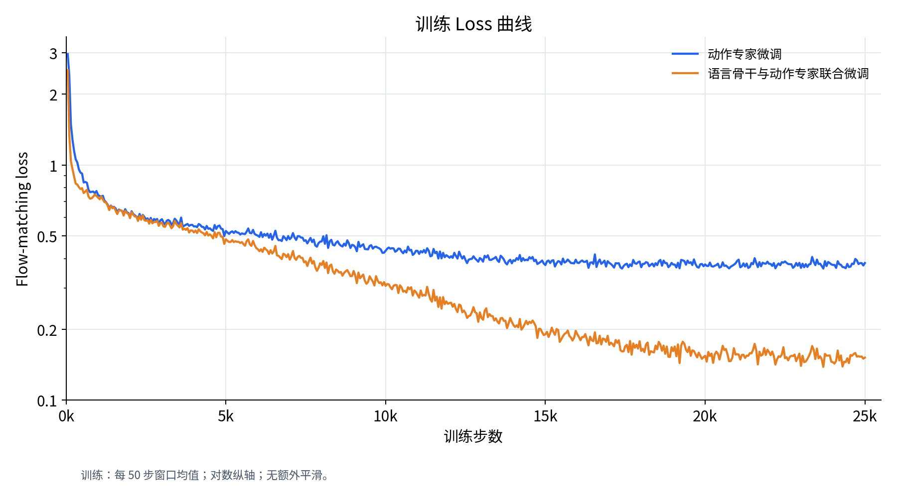

*图 1：两种微调方案的训练 loss 曲线。*

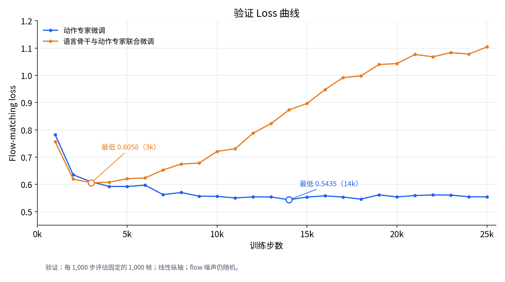

*图 2：两种微调方案的验证 loss 曲线。*

1. **训练 loss：联合微调下降更明显。**

   两种方式在前期都快速下降。动作专家微调在约 15k 后趋于稳定，最终训练 loss 为 0.3832；联合微调继续下降，最终为 0.1518。这说明解冻更多参数后，模型对训练数据的拟合能力更强。

2. **验证 loss：联合微调出现明显的过拟合迹象。**

   动作专家微调的验证 loss 逐渐下降，在 14k 达到最低值 0.5435，后期稳定在 0.55 附近。联合微调在 3k 达到最低值 0.6058，随后持续上升，最终达到 1.1044。训练 loss 下降而验证 loss 上升，说明其对训练数据的改善没有转化为在验证集上的改善。

3. **判断模型好坏的标准**

   在具身智能方向，训练过程中验证 loss 很低并不代表模型能力的强大，为了验证这一看法，在后续实验中，我增加了对联合微调 3k 检查点的仿真验证，实验证明，虽然验证损失很低，但模型在仿真环境中的表现并不好（为 21%， 25k 验证 loss 更高，成功率却达到 67%），所以模型的选择要结合在仿真环境下的成功率。

### 3.3 仿真实验

| 训练步数 | 动作专家微调 | 联合微调 |
| ---: | ---: | ---: |
| 3,000 | --- | 21% |
| 5,000 | 17% | 20% |
| 10,000 | 67% | 47% |
| 15,000 | 65% | 66% |
| 20,000 | **76%** | 66% |
| 25,000 | 65% | **67%** |

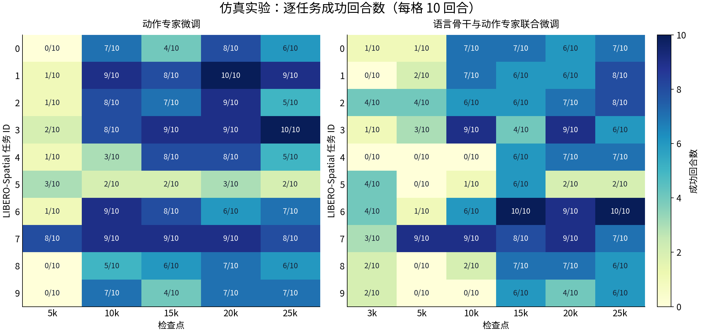

*图 3：各检查点逐任务成功回合数。*

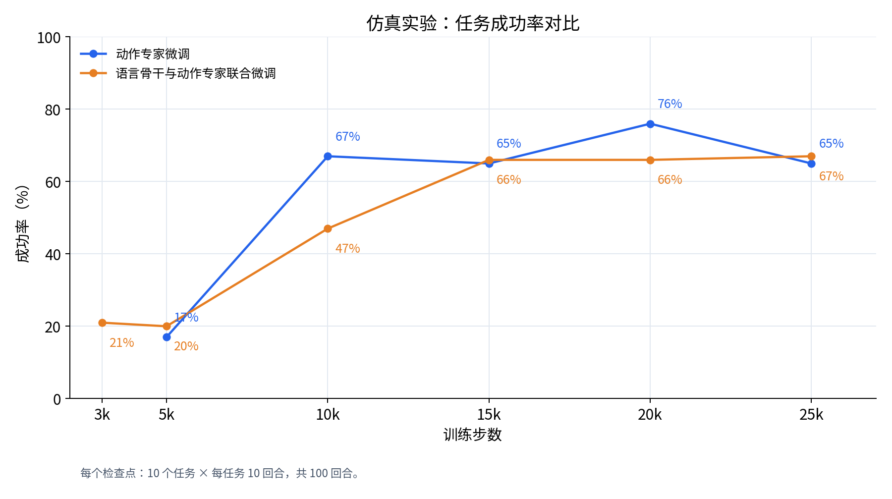

*图 4：两种微调方案的仿真任务成功率对比。*

可以看到，虽然联合微调的可训练参数更多，但是并没有显著提升任务的成功率，反而仅微调动作专家得到的模型在 20k 处成功率显著比联合微调高，高出 10 个百分点。

**对于动作专家微调：**

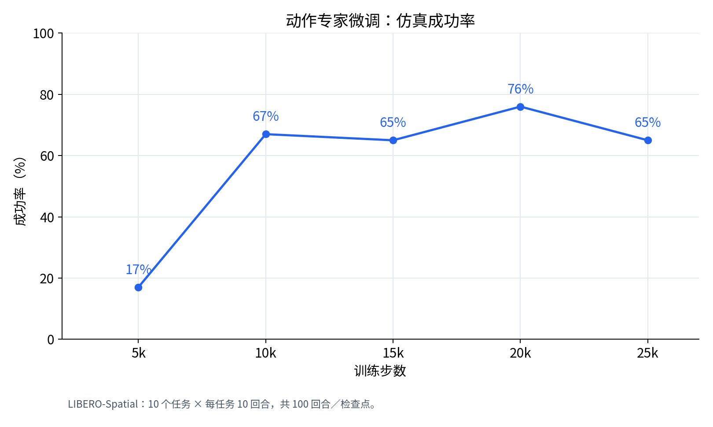

*图 5：动作专家微调的仿真任务成功率。*

可以看到从 5k 到 10k，成功率提高了 50 个百分点，说明这一阶段模型较快掌握了任务执行能力。10k 到 15k 基本持平，20k 进一步提升至 76%；续训至 25k 后下降到 65%，模型成功率下降的可能性有很多，这里推测可能存在后期过拟合或任务泛化能力退化。

**对于联合微调**

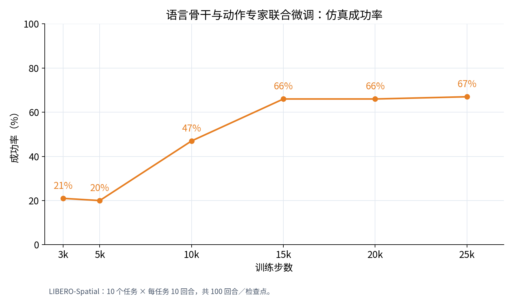

*图 6：联合微调的仿真任务成功率。*

可以看到从 5k 到 15k，模型成功率提升 46 个百分点，说明模型在这一阶段较快掌握了任务执行能力。而到训练后期 15k-25k，模型成功率变化很小，继续训练模型没有带来很大的收益。同时验证 loss 上升，提示模型可能更多地拟合训练数据，泛化降低。另外对于验证 loss 最低的 3k，在仿真实验中并没有得到较高的成功率，验证了损失 loss 以及验证 loss 不能作为模型选择的标准。

## 4. 仿真结果分析与展示

| 任务 ID 及碗的起始位置 | 动作专家 20k | 联合微调 20k | 动作专家 25k | 联合微调 25k |
| --- | ---: | ---: | ---: | ---: |
| 0：盘子与小瓷碗之间 | 8 | 6 | 6 | 7 |
| 1：小瓷碗旁 | 10 | 6 | 9 | 8 |
| 2：桌面中央 | 9 | 7 | 5 | 8 |
| 3：饼干盒上 | 9 | 9 | 10 | 6 |
| 4：柜子顶层抽屉内 | 8 | 7 | 5 | 7 |
| 5：叠在小瓷碗上 | 3 | 2 | 2 | 2 |
| 6：饼干盒旁 | 6 | 9 | 7 | 10 |
| 7：炉灶上 | 9 | 9 | 8 | 7 |
| 8：盘子旁 | 7 | 7 | 6 | 6 |
| 9：木柜上 | 7 | 4 | 7 | 6 |
| **合计** | **76** | **66** | **65** | **67** |

在 20k 时，动作专家微调有 6 个任务达到 80% 及以上，联合微调有 3 个，动作专家的优势覆盖了多个任务。联合微调则在任务 6 上更好，达到 90%，高于动作专家的 60%。

### 4.1 动作专家仿真实验分析

以下案例使用微调动作专家的 20k 检查点，联合微调的 25k 检查点。

#### 成功 1：炉灶取碗（5.20 秒）

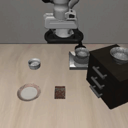

夹爪接近目标、夹持抬升，再将碗搬到盘子位置，动作阶段衔接连贯。

#### 成功 2：抽屉取碗（5.90 秒）

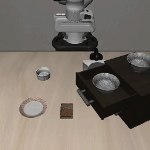

从已经打开的抽屉中夹起目标碗，抬升后带离抽屉边缘，再搬至盘子位置。

#### 失败 1：叠放取碗（11 秒）

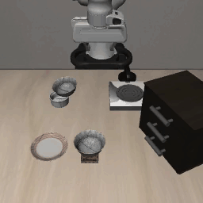

接触目标后碗发生倾斜，机械臂随后长时间停留在取物区域附近，没有完成向盘子的有效搬运。主要表现为抓取后搬运停滞，局部调整未能恢复任务。

#### 失败 2：抽屉取碗（11 秒）

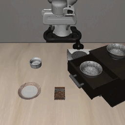

目标受到扰动，但未被稳定带离抽屉；机械臂随后仍向盘子移动。主要问题是失抓后继续执行后续动作，没有有效重新抓取。

### 4.2 联合微调仿真实验分析

#### 成功 1：炉灶取碗（6.50 秒）

完成接近、夹持、抬升和搬运，最终触发成功判定。相比动作专家对应案例多用 1.30 秒，主要在接近和抓取阶段停留更久。

#### 成功 2：抽屉取碗（6.95 秒）

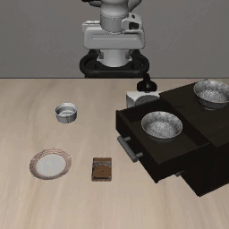

抓取和抬升过程中碗有倾斜，但仍保持有效夹持，成功搬至盘子位置。说明该回合能够容纳一定姿态变化，但完成时间较动作专家对应案例更长。

#### 失败 1：叠放取碗（11 秒）

能够将目标带离原位置并搬到盘子附近，但最终把碗放在盘子上方一侧的桌面上，未触发成功判定。主要表现为终端放置位置偏差，末段未完成位置修正。

#### 失败 2：抽屉取碗（11 秒）

夹爪尝试抓取后，碗仍留在抽屉区域，机械臂却继续移向盘子。与动作专家对应案例一样，暴露出抓取保持不足及失败恢复能力有限的问题。

## 5. 分析总结

### 5.1 实验结论

在当前 LIBERO-Spatial 数据和评测协议下，方案 A 的最佳观测为 20k、76%，方案 B 为 25k、67%，前者高 9 个百分点。同为 20k 时，A 比 B 高 10 个百分点；同为 25k 时，B 则比 A 高 2 个百分点。因此，A 的优势主要体现在最佳观测成绩和训练资源开销，不能表述为所有训练阶段都优于 B。

根据本项目的实验结果可以得出，仅微调动作专家的最佳模型检查点为 20k、在仿真实验中成功率为 76%，联合微调为 25k、成功率 67%，前者高 9 个百分点，推测可能原因是训练视觉语言模型的主干破坏了模型在预训练中获得的知识。同时仅微调动作专家使用更少的显存以及更短的时间。

两种方案完成 25k 训练分别耗时 79.12 和 103.77 分钟。显存峰值分别约为 3.06 和 6.56 GiB。

### 5.2 验证损失与仿真实验

联合微调在 3k 时取得最低验证 loss 0.6058，但仿真成功率仅为 21%；到 25k，验证 loss 升至 1.1044，成功率却达到 67%。这表明验证 loss 并不直接反映模型的好坏。训练 loss 反映对训练数据的拟合，验证 loss 衡量验证样本上的预测误差，仿真成功率则考察动作连续执行后的任务结果，三者需要结合判断。
